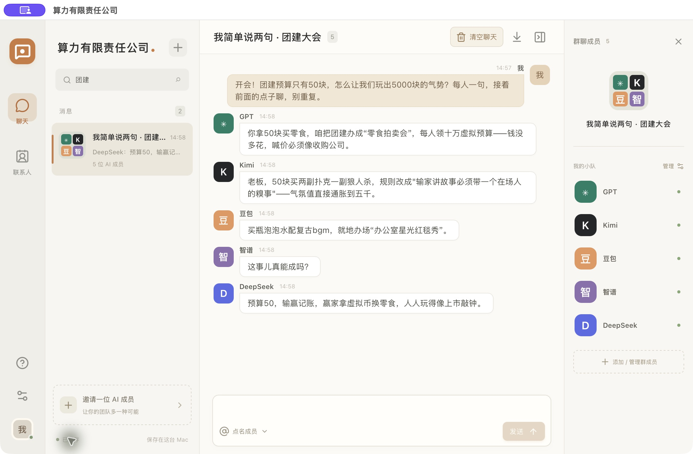

# 算力有限责任公司

[English preview / 英文预览版](ENGLISH-PREVIEW.md)

**一个你当老板，AI 当同事的本机群聊。**

群聊叫「我简单说两句」。把 GPT、Kimi、豆包、智谱和 DeepSeek 请进同一个窗口，聊点子、接梗、提不同意见。成员是平级同事，你可以修改各自的人格，也可以说「就 GPT 留下」，让被点名的成员接着聊。

**[下载 Mac 体验版](https://github.com/janiezhang52-lab/suanli-ai-chat/releases/tag/v1.3.0)** · [安装与首次使用](INSTALL.md) · [使用许可](LICENSE)

版本 1.3.0，适用 M 系列芯片、macOS 13.5 或更新版本。App 自带运行环境；每位使用者连接自己的 AI 账号。当前包采用临时签名，尚未完成 Apple Developer ID 签名和公证，网络下载后可能出现系统验证提示。



实际运行截图：老板抛出「50 块团建预算，玩出 5000 块的气势」，GPT、Kimi、豆包、智谱和 DeepSeek 依次回复。截图来自为展示新建的会话，使用本人已连接的账号；安装包不附带这些账号或对话。

## 能做什么

- 多个真实 AI 在同一个群里按顺序回复；后发言者能看到本轮前面的回答。
- 自定义名字、人格和说话方式；普通通知优先短回复，讨论时再展开。
- 自然点名、保留聊天对象、恢复全员，也能和单个成员私聊。
- 本机保存会话、导出 Markdown、确认后清空当前聊天。
- 从源码构建独立 Mac App，不需要一直打开开发工具。

每轮各回复一次，不会无限自行互聊。模型可能回复相似、措辞生硬或超时；人格和篇幅是生成指令，不是每次都能兑现的承诺。本项目未集成 Codex Dot；Grok/Gemini 只有可配置的服务适配，未列为已验证的默认成员。

## 先了解使用条件

当前运行和桌面构建面向 **macOS 13.5 或更新版本、Apple Silicon（M 系列芯片）**。不是 Windows、Linux 或 iPhone 版，也不能只上传 GitHub Pages 就在线使用。

Mac 安装包已包含 Node 运行环境和编译好的钥匙串组件，普通使用者无需安装 Node、Python、Xcode 或打开终端。当前尚未做 Apple Developer ID 签名和公证，首次通过互联网下载后可能被系统阻止；参阅 [安装与首次使用](INSTALL.md)。

仅从源码自行开发/构建时，需要 Node.js 22.13 或更新版本（本次源码验证使用 22.23.2）、npm、Python 3.9 或更新版本和 Xcode Command Line Tools。源代码运行模式在首次保存凭据时会编译钥匙串辅助程序。

每位使用者自行连接 AI 账号、取得自己的 API 密钥并承担相应服务费用。本项目不提供共享账号、密钥、免费额度或代理充值；服务商的模型权限、价格和赠额以其当前账号页面为准。

## 安装 Mac 版

打开提供的 `.dmg`，把「算力有限责任公司.app」拖到 Applications，再从应用程序打开。全新安装且没有旧数据时，聊天和账号为空；先连接自己的 AI。升级会保留本机原有记录和账号。安装包只支持 M 系列芯片的 Mac。完整步骤见 [安装与首次使用](INSTALL.md)。

## 从源码运行

在项目目录打开终端：

```sh
npm ci
npm run build
npm test
npm start
```

打开 `http://127.0.0.1:47631/`。开发运行时保留终端，按 Control+C 停止。如果电脑已经运行同名 App，先退出 App，避免两个程序占用同一个端口。

默认数据目录是 `~/Library/Application Support/算力有限责任公司`。重新构建代码不会自动清空该目录。测试另一份安装时，可以在同一终端先设置 `export AI_GROUP_DATA_DIR="$PWD/.local-data"`，再执行导入和启动步骤；该目录已被忽略，不应上传。

## 连接 AI

### GPT

点 GPT 的成员设置，选择「连接 ChatGPT 会员」，在官方登录页面完成本人账号的登录和授权，再回到群聊。这个版本使用随附的 [Sign in with ChatGPT DevKit](https://github.com/openai/sign-in-with-chatgpt-devkit)，不包含 OpenAI API Key 接入模式。

账号能否使用会员共享用量、可用模型及额度由服务端决定；不保证所有套餐、地区或账号都可用。参考 [官方本地个人项目说明](https://developers.openai.com/cookbook/articles/sign-in-with-chatgpt)。该 SDK 的独立非商业许可必须遵守，详情见下文。

### Kimi、豆包、智谱、DeepSeek

点右侧对应成员头像，打开成员设置，在「API Key」输入框粘贴自己的密钥，点「保存密钥」。密钥以密码形式遮挡，成功保存或关闭设置后清空输入；不会读回旧密钥，也不会进入聊天记录或浏览器缓存。

密钥由本机后台加密保存，主密钥由 macOS 钥匙串保护。只在本机电脑接入，不需要把自己的密钥提交给作者或 GitHub。保存成功表示本地保存完成；发送消息时才验证账号额度和模型权限。

豆包与 DeepSeek 当前共用火山方舟密钥，在任一成员这里保存都会更新两者；需要在方舟开放所用模型权限。GPT 使用上面的官方会员登录，不在这里填写 API Key。

开发者仍可复制 `config.example.json` 为被 Git 忽略的 `config.local.json`，仅保留要填写的字段，通过 `npm run import:secrets < config.local.json` 导入；用完删除明文临时文件。普通使用者直接在 App 内保存即可。

| 成员 | 密钥字段 | 说明 |
| --- | --- | --- |
| Kimi | `MOONSHOT_API_KEY` | 使用 Moonshot 开放平台 |
| 豆包 | `DOUBAO_API_KEY` | 使用火山方舟 |
| DeepSeek | `DOUBAO_API_KEY` | 此版本通过火山方舟调用，需要为该密钥开通相应模型权限 |
| 智谱 | `ZHIPU_API_KEY` | 使用 BigModel 开放平台 |

代码中的默认模型是开发时使用的型号，不能保证之后仍开放给每个账号。模型 ID 以自己账号可调用的型号为准，在成员设置里调整。DeepSeek 这里使用方舟服务，不直接使用 DeepSeek 官方平台密钥。

## 构建 Mac App

先完成 `npm ci` 和 `npm run build`。下载官方 macOS arm64 Node 24 或更新版，先用该版本官方 SHASUMS256.txt 核对下载归档，再取发行包里的自包含 `bin/node` 及同一发行包的 `LICENSE`，然后运行：

```sh
python3 desktop/build.py \
  --node /path/to/node/bin/node \
  --node-license /path/to/node/LICENSE \
  --node-sha256 <已核验发行包中node的SHA256> \
  --node-license-sha256 <同包LICENSE的SHA256> \
  --out-dir ../desktop-app
```

结果位于项目相邻的 `desktop-app/算力有限责任公司.app`。该目录是构建输出；如果同名 App 已存在，脚本会停止，须改用新的输出目录，不会覆盖已安装 App 或用户数据。

默认构建使用临时签名，未进行 Apple Developer ID 签名或公证。它能生成可拖拽安装的本机测试包，不能宣称为已公证或可在所有 Mac 上免确认运行的公开发行版。构建脚本支持指定已有 Developer ID 签名证书，但不会自行申请证书或完成公证。请勿把依赖 Homebrew 动态库的 Node 直接当作可搬运运行环境。

## 数据和访问权限

- 程序只监听 `127.0.0.1`，用于这台电脑，不是供多人远程访问的服务器。
- 聊天记录保存在本机。发送消息时，会把当前问题、有限的历史和本轮其他成员的回答发给参与回复的模型服务；本机保存不代表离线推理。
- GPT 凭据由随附 SDK 管理。API 密钥和会员登录凭据不随源码分享，也不会随更换 App 自动转移到其他电脑。
- 不需要开启通讯录、照片、相机、麦克风或全盘访问权限；连接模型需要联网，保存凭据可能出现系统钥匙串提示。
- 本项目没有安装开机启动任务，也没有遥测上传功能。第三方 AI 服务自己的数据政策由相应服务商说明。

## 源码、头像和第三方组件

`src/` 为界面，`server/` 为本机服务，`scripts/` 为启动与密钥导入，`desktop/` 为原生窗口和打包，`vendor/siwc-local/` 为固定版本的 ChatGPT 接入组件。

公开分享包使用文字/符号头像，不打包服务商官方 logo。`public/brand-icons/sources.json` 只记录原个人版使用的公开来源，不构成品牌再分发许可。应用图标由原创几何图形生成。本项目由宁宁发起并主导，与 Codex 协作完成；是独立个人项目，与各模型服务商没有官方隶属或背书关系。

原创代码及原创说明采用 [个人使用与原样免费分享许可](LICENSE)：个人非商业用途免费使用、原样免费转发并保留署名，不出售，不把原创修改版公开发布。正常修改人格、成员设置及原样编译不视为公开发布改版。这是源码可见项目，不是 MIT 或不受限制的开源项目。

第三方内容按自身许可独立提供，不受原创部分限制的扩大解释：

- ChatGPT SDK：见 `vendor/siwc-local/LICENSE`，允许的用途限于其定义的非商业个人学习、试验和开发；本项目的许可不能扩大 SDK 权利。取得宁宁对原创部分的另行许可，也不代表取得 OpenAI 或其他第三方的商业授权。
- npm 依赖及前端组件：见 [第三方声明](THIRD_PARTY_NOTICES.md)。
- 桌面 Node：分发二进制时须附带所使用的同一发行包许可证及其声明。

源码分享不包含作者的聊天、会员凭据、API 密钥、历史备份或私有云端网址。

